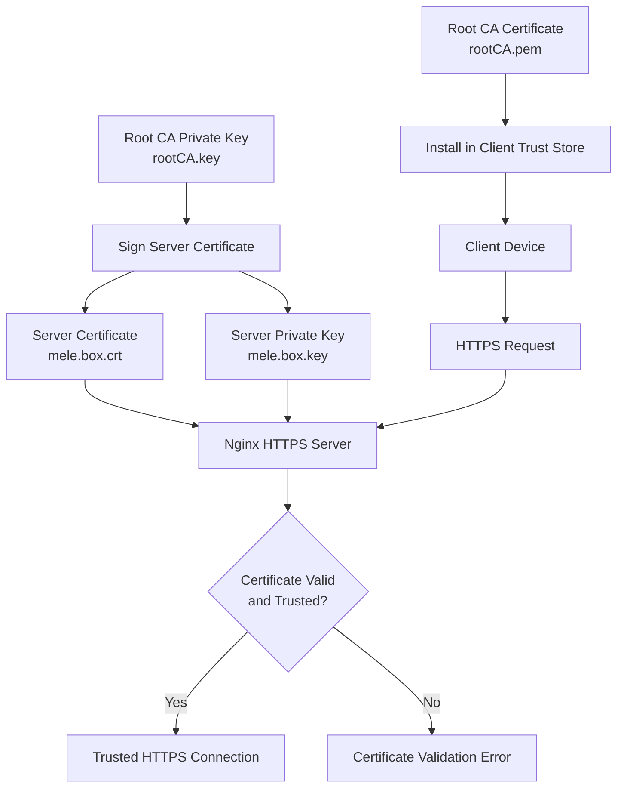
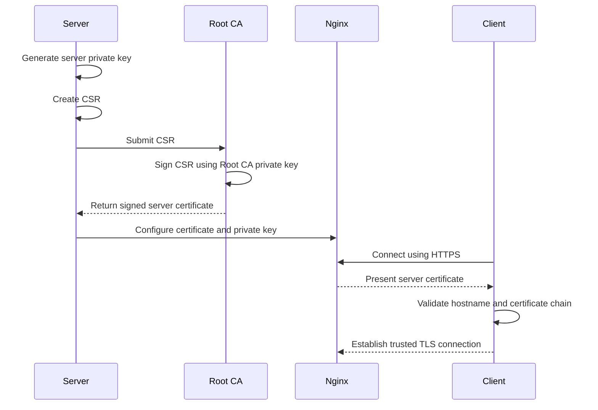
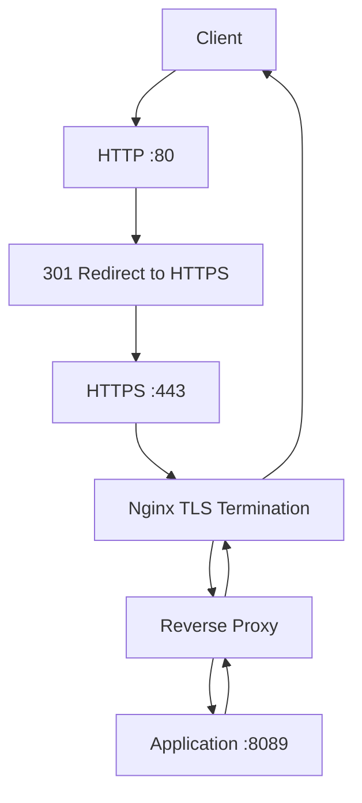
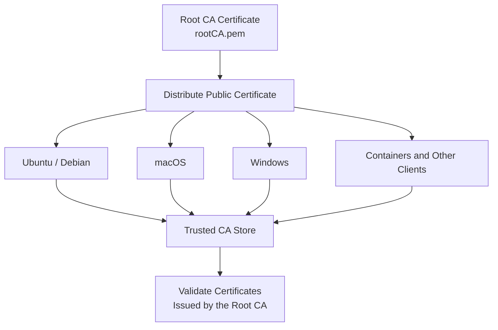
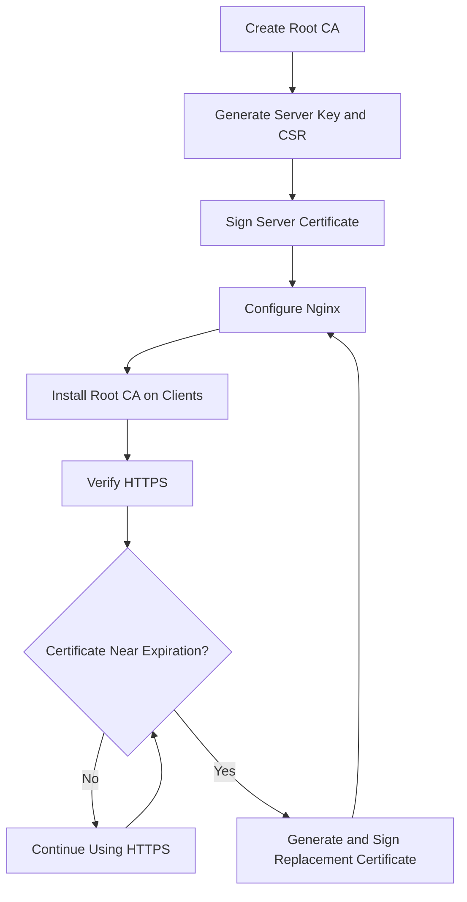

# Root Certificate Authority

A private Root Certificate Authority (CA) for managing trusted TLS certificates across a self-hosted home lab.

This repository documents how to create a self-signed Root CA using OpenSSL, issue TLS certificates for internal services, configure Nginx for HTTPS, and establish trust between your servers and client devices.

The example configuration uses `mele.box` as the primary hostname and `*.mele.box` for subdomains.

## Table of Contents

- [Overview](#overview)
- [Architecture](#architecture)
- [Prerequisites](#prerequisites)
- [1. Create the Root CA](#1-create-the-root-ca)
- [2. Generate a Server Certificate](#2-generate-a-server-certificate)
- [3. Configure Nginx](#3-configure-nginx)
- [4. Trust the Root CA](#4-trust-the-root-ca)
- [5. Verify the Configuration](#5-verify-the-configuration)
- [Certificate Lifecycle](#certificate-lifecycle)
- [Troubleshooting](#troubleshooting)
- [Security Considerations](#security-considerations)

## Overview

A private Root CA allows you to issue TLS certificates for services running on your own network without purchasing a certificate for every internal hostname.

For example, you can use HTTPS for services such as:

- `https://mele.box`
- `https://portainer.mele.box`
- `https://immich.mele.box`
- `https://passbolt.mele.box`

The Root CA signs server certificates. Once a client trusts the Root CA certificate, it can validate certificates issued by that authority, provided the certificates are valid and the hostnames match.

> **Important:** A private CA is suitable for internal services and development environments. It does not automatically become trusted by browsers or devices. You must install its public root certificate in the appropriate trust store on each client.

## Architecture

The Root CA establishes a chain of trust between client devices and internal services.



### Certificate Files

| File | Purpose | Sensitivity |
|---|---|---|
| `rootCA.key` | Signs certificates issued by the Root CA | **Highly sensitive** |
| `rootCA.pem` | Public Root CA certificate | Public |
| `rootCA.crt` | Copy of the public Root CA certificate | Public |
| `mele.box.key` | Private key used by the server | Sensitive |
| `mele.box.csr` | Certificate Signing Request (CSR) | Public |
| `mele.box.ext` | Certificate extensions, including Subject Alternative Names | Public |
| `mele.box.crt` | Signed TLS server certificate | Public |

The Root CA private key must never be copied to client devices or exposed to applications that only need to serve HTTPS.

## Prerequisites

The examples assume an Ubuntu-based server and an internal DNS configuration that resolves `mele.box` to your server.

Required software:

- OpenSSL
- Nginx
- `sudo` privileges
- DNS records for the internal hostnames

Install the required packages:

```bash
sudo apt update
sudo apt install openssl nginx ca-certificates
```

Verify that OpenSSL is available:

```bash
openssl version
```

Ensure that `mele.box` resolves to the correct server address before testing HTTPS.

## 1. Create the Root CA

The Root CA consists of a private key and a self-signed certificate.

The example uses a 4096-bit RSA key and a certificate valid for ten years.

### 1.1 Create the certificate directory

```bash
sudo mkdir -p /etc/nginx/ssl
sudo chmod 700 /etc/nginx/ssl
cd /etc/nginx/ssl
```

### 1.2 Generate the Root CA private key

```bash
sudo openssl genrsa -out rootCA.key 4096
sudo chmod 600 rootCA.key
```

This creates the private key used to sign server certificates.

**Keep this key secure.** Anyone who obtains it can potentially issue certificates trusted by every device that trusts this Root CA.

### 1.3 Generate the self-signed Root CA certificate

```bash
sudo openssl req -x509 -new -nodes -sha256 -days 3650 \
  -key rootCA.key \
  -subj "/C=NP/ST=Bagmati/L=Kathmandu/O=HomeLab CA/OU=Root/CN=mele.box Root CA" \
  -addext "basicConstraints=critical,CA:TRUE" \
  -addext "keyUsage=critical,keyCertSign,cRLSign" \
  -addext "subjectKeyIdentifier=hash" \
  -out rootCA.pem
```

Create a `.crt` copy for convenience:

```bash
sudo cp rootCA.pem rootCA.crt
```

Set appropriate permissions:

```bash
sudo chmod 644 rootCA.pem rootCA.crt
sudo chmod 600 rootCA.key
```

The `.pem` and `.crt` files contain the same public certificate. The extensions indicate the file's intended naming convention, not necessarily a different encoding.

### 1.4 Inspect the Root CA certificate

```bash
openssl x509 -in rootCA.pem -noout -text
```

Check the certificate's validity period and CA extensions:

```bash
openssl x509 -in rootCA.pem -noout \
  -subject -issuer -dates
```

Because this is a self-signed Root CA, the issuer and subject should match.

## 2. Generate a Server Certificate

The server certificate allows Nginx to establish HTTPS connections for `mele.box` and its subdomains.

The process consists of generating a server private key, creating a CSR, and signing the request with the Root CA.

### 2.1 Create the server certificate extensions

Create an extension file:

```bash
sudo tee /etc/nginx/ssl/mele.box.ext > /dev/null <<'EOF'
authorityKeyIdentifier = keyid,issuer
basicConstraints       = CA:FALSE
keyUsage               = critical,digitalSignature,keyEncipherment
extendedKeyUsage       = serverAuth
subjectAltName         = @alt_names

[alt_names]
DNS.1 = mele.box
DNS.2 = *.mele.box
EOF
```

The `subjectAltName` extension identifies the hostnames covered by the certificate.

- `mele.box` covers the base hostname.
- `*.mele.box` covers one-level subdomains, such as `portainer.mele.box`.

A wildcard does not cover the base hostname by itself, which is why both entries are included.

### 2.2 Generate the server private key

```bash
cd /etc/nginx/ssl

sudo openssl genrsa -out mele.box.key 2048
sudo chmod 600 mele.box.key
```

This key belongs to the server, not the Root CA.

### 2.3 Generate the Certificate Signing Request

```bash
sudo openssl req -new -sha256 \
  -key mele.box.key \
  -subj "/CN=mele.box" \
  -out mele.box.csr
```

The CSR contains the server's requested identity and public key. The hostname coverage is added through the extension file when the certificate is signed.

### 2.4 Sign the server certificate

```bash
sudo openssl x509 -req -sha256 -days 825 \
  -in mele.box.csr \
  -CA rootCA.pem \
  -CAkey rootCA.key \
  -CAcreateserial \
  -extfile mele.box.ext \
  -out mele.box.crt
```

This produces `mele.box.crt`, a server certificate signed by the Root CA.

The command also creates `rootCA.srl`, which OpenSSL uses to track the signing serial number for subsequent certificates.

Set the server certificate's permissions:

```bash
sudo chmod 644 mele.box.crt
sudo chmod 600 mele.box.key
```

**Note:** This example uses an 825-day certificate lifetime. Renew the server certificate before it expires. The Root CA and server certificates have separate validity periods.

### Certificate Issuance Flow



## 3. Configure Nginx

Configure Nginx to use the server certificate and private key.

The following example assumes the application is listening on `localhost:8089`.

Create or edit the Nginx site configuration:

```bash
sudo nano /etc/nginx/sites-available/mele.box
```

Add the following configuration:

```nginx
server {
    listen 80;
    server_name mele.box;

    return 301 https://$host$request_uri;
}

server {
    listen 443 ssl;
    http2 on;

    server_name mele.box;

    ssl_certificate     /etc/nginx/ssl/mele.box.crt;
    ssl_certificate_key /etc/nginx/ssl/mele.box.key;

    ssl_protocols TLSv1.2 TLSv1.3;

    location / {
        proxy_pass http://localhost:8089;

        proxy_set_header Host $host;
        proxy_set_header X-Real-IP $remote_addr;
        proxy_set_header X-Forwarded-For $proxy_add_x_forwarded_for;
        proxy_set_header X-Forwarded-Proto https;
    }
}
```

The HTTP server redirects requests to HTTPS. The HTTPS server terminates TLS and forwards requests to the backend application.

Enable the configuration:

```bash
sudo ln -s /etc/nginx/sites-available/mele.box \
  /etc/nginx/sites-enabled/mele.box
```

If the symbolic link already exists, do not create it again.

Validate the configuration:

```bash
sudo nginx -t
```

Reload Nginx:

```bash
sudo systemctl reload nginx
```

### Nginx Request Flow



### Using the certificate for additional services

You can reuse the certificate for subdomains covered by `*.mele.box`.

For example, a separate Nginx server block can use:

```nginx
server {
    listen 443 ssl;
    http2 on;

    server_name portainer.mele.box;

    ssl_certificate     /etc/nginx/ssl/mele.box.crt;
    ssl_certificate_key /etc/nginx/ssl/mele.box.key;

    location / {
        proxy_pass http://localhost:9000;

        proxy_set_header Host $host;
        proxy_set_header X-Forwarded-Proto https;
        proxy_set_header X-Forwarded-For $proxy_add_x_forwarded_for;
    }
}
```

Adjust the backend port and other proxy settings for your application.

The certificate will work for this hostname only if DNS resolves it correctly and the hostname matches the certificate's Subject Alternative Name.

## 4. Trust the Root CA

Clients must trust `rootCA.pem` before they can validate certificates issued by this Root CA without a trust warning.

Only distribute the public Root CA certificate. **Never distribute `rootCA.key`.**

### Ubuntu and Debian

Copy the certificate into the system's local CA directory:

```bash
sudo cp /etc/nginx/ssl/rootCA.pem \
  /usr/local/share/ca-certificates/mele-rootCA.crt
```

Update the trust store:

```bash
sudo update-ca-certificates
```

The certificate should now be available to applications that use the system trust store.

If the certificate is already installed, update or replace the existing file as appropriate before refreshing the trust store.

### Other operating systems and applications

- **macOS:** Import the public Root CA certificate into the appropriate Keychain trust store.
- **Windows:** Import the public Root CA certificate into the appropriate Trusted Root Certification Authorities store.
- **Browsers:** Check whether the browser uses the operating system's trust store or maintains its own certificate authorities.
- **Containers:** Install the public Root CA certificate inside each container that needs to trust services signed by this CA.

The exact procedure depends on the operating system, browser, application, and trust-store configuration.

### Trust Distribution Flow



## 5. Verify the Configuration

Perform the following checks after generating the certificates, configuring Nginx, and installing the Root CA on the client.

### 5.1 Verify the server certificate

Inspect the certificate:

```bash
openssl x509 -in /etc/nginx/ssl/mele.box.crt \
  -noout -subject -issuer -dates
```

Check the Subject Alternative Names:

```bash
openssl x509 -in /etc/nginx/ssl/mele.box.crt \
  -noout -ext subjectAltName
```

You should see:

```text
DNS:mele.box, DNS:*.mele.box
```

### 5.2 Verify the certificate chain

Run:

```bash
openssl verify \
  -CAfile /etc/nginx/ssl/rootCA.pem \
  /etc/nginx/ssl/mele.box.crt
```

Expected result:

```text
/etc/nginx/ssl/mele.box.crt: OK
```

This checks whether the certificate validates against the specified Root CA. It does not, by itself, test Nginx, DNS, or network connectivity.

### 5.3 Test the HTTPS endpoint

From a client where the Root CA is trusted:

```bash
curl -I https://mele.box
```

To test using a specific CA file without modifying the client's trust store:

```bash
curl --cacert /path/to/rootCA.pem \
  -I https://mele.box
```

The server must be reachable and DNS must resolve the hostname correctly.

### 5.4 Inspect the live TLS connection

```bash
openssl s_client \
  -connect mele.box:443 \
  -servername mele.box \
  -CAfile /etc/nginx/ssl/rootCA.pem \
  -verify_hostname mele.box \
  -verify_return_error
```

A successful verification should report:

```text
Verify return code: 0 (ok)
```

This checks the live TLS connection, certificate chain, and requested hostname.

## Certificate Lifecycle

A typical certificate lifecycle consists of creating the Root CA once, issuing server certificates when needed, installing the Root CA on clients, and renewing server certificates before expiration.



The Root CA should generally remain stable. Recreating it generates a different trust anchor, so clients that trusted the old certificate will not automatically trust certificates issued by the new one.

For a larger environment, consider using an offline Root CA and an intermediate CA for day-to-day certificate issuance. This reduces the need to expose the Root CA private key during routine operations.

## Troubleshooting

### `curl: (60) SSL certificate problem`

**Possible cause:** The Root CA is not trusted, the server is presenting an unexpected certificate, or the certificate chain cannot be validated.

Check the server certificate:

```bash
openssl s_client \
  -connect mele.box:443 \
  -servername mele.box \
  -showcerts
```

Verify the certificate against the Root CA:

```bash
openssl verify \
  -CAfile /etc/nginx/ssl/rootCA.pem \
  /etc/nginx/ssl/mele.box.crt
```

Confirm that the Root CA is installed in the trust store used by the client.

### Hostname mismatch

**Possible cause:** The requested hostname is not listed in the certificate's Subject Alternative Name.

Inspect the SAN extension:

```bash
openssl x509 -in /etc/nginx/ssl/mele.box.crt \
  -noout -ext subjectAltName
```

Ensure that the certificate covers the hostname you are visiting.

### Nginx fails to start or reload

Check the configuration:

```bash
sudo nginx -t
```

Check the service status:

```bash
sudo systemctl status nginx
```

Inspect recent logs:

```bash
sudo journalctl -u nginx -n 100 --no-pager
```

Verify that the certificate and key paths exist and that Nginx has permission to read the files.

### `mele.box` does not resolve

Check DNS resolution:

```bash
getent hosts mele.box
```

Confirm that your internal DNS server contains the appropriate record and that the client is using the expected DNS server.

Certificate validation cannot succeed against the intended service if the hostname resolves to the wrong server.

### A certificate has expired

Inspect its validity dates:

```bash
openssl x509 -in /etc/nginx/ssl/mele.box.crt \
  -noout -dates
```

Generate a replacement server certificate using the existing trusted Root CA, update the Nginx configuration if necessary, and reload Nginx.

Installing a new server certificate does not require reinstalling the Root CA if the Root CA itself remains unchanged and trusted.

## Security Considerations

A private Root CA is powerful: any certificate it signs may be trusted by devices that have installed its root certificate.

Follow these practices:

1. **Protect the Root CA private key.** Restrict filesystem permissions and keep the key in a secure location.
2. **Keep the Root CA offline when practical.** Consider issuing server certificates through an intermediate CA rather than routinely using the Root CA key.
3. **Distribute only public certificates.** Clients need `rootCA.pem` or `rootCA.crt`, not `rootCA.key`.
4. **Use hostname validation.** Include the required DNS names in the Subject Alternative Name extension.
5. **Renew certificates before expiration.** Monitor both the Root CA and server certificate validity periods.
6. **Use the appropriate certificate extensions.** A server certificate should not be marked as a CA certificate.
7. **Restrict access to server private keys.** Only authorized services and administrators should be able to access them.
8. **Plan for compromise.** If the Root CA private key is compromised, you may need to replace the Root CA and update trust on every affected client.

### Scope and Limitations

This setup provides certificate issuance and TLS configuration for internal services. It does not automatically provide:

- Public browser trust.
- Automated certificate renewal.
- Certificate revocation management.
- Centralized certificate inventory.
- Automatic certificate deployment across services.
- A complete certificate management system.

These capabilities require additional tooling and operational procedures.

---

## License

Add a license file and specify the applicable license here if you intend to distribute this repository for reuse.
